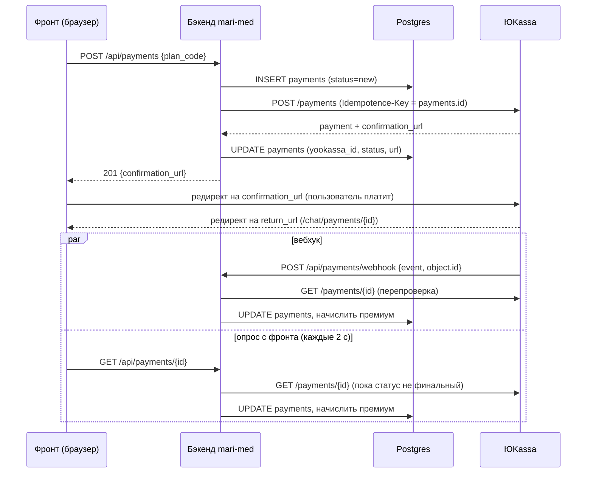

# Mari Med — оплата и подписки: как это работает

Разобрано по коду ветки `feat/yookassa-payments` (бэкенд `mari_med/src/gen_recommendations`).
Три независимые идеи, склеенные вместе:

1. **Платежи** — ЮKassa, сценарий «редирект».
2. **Подписка и лимит** — бесплатному пользователю даётся N запросов к `/recommendation`, премиуму — без лимита.
3. **Фича-флаг `subscriptions`** — выключатель всего этого без деплоя. Выключен → сервис работает как раньше.

---

## 1. Карта кода

| Что | Где |
|---|---|
| Роуты платежей (создать, статус, список, вебхук) | `entrypoints/routes/payments.py` |
| Клиент ЮKassa (HTTP) | `service/yookassa.py` |
| Тарифы, лимит, начисление премиума | `service/billing.py` |
| Фича-флаги (логика и кэш) | `service/feature_flags.py` |
| «Кто я и что мне доступно» для фронта | `entrypoints/routes/me.py` → `GET /me` |
| Админка флагов | `entrypoints/routes/admin.py` → `/admin/feature-flags*` |
| Счётчик запросов, место подключения лимита | `entrypoints/routes/main.py` → `POST /recommendation` |
| Роли (`admin`, `premium`), токен | `entrypoints/auth.py` |
| Репозитории (SQL) | `interfaces/repositories.py` |
| Таблицы | `models/dialogs.py` |
| Настройки | `core/settings.py` (`YooKassaSettings`, `BillingSettings`) |

## 2. Таблицы БД

| Таблица | Что хранит |
|---|---|
| `payments` | Наша запись о платеже: `id` (uuid), `yookassa_id`, `user_sub`, сумма, `status`, `confirmation_url`, `plan_code`, `entitlement_granted_at` |
| `subscriptions` | Одна строка на пользователя: `active_until` (до какой даты премиум) |
| `user_usage` | Одна строка на пользователя: `recommendations_used` (сколько запросов потрачено) |
| `feature_flags` | Переопределения флагов из админки (`key`, `state`, `include_admins`) |
| `feature_flag_targets` | Пользователи, которым флаг включён точечно |
| `feature_flag_audit` | Кто и когда менял флаги |

`user_sub` — это `sub` из токена Keycloak. Внешних ключей на пользователей нет: пользователи живут в Keycloak, не в нашей БД.

## 3. Тарифы

Заданы **в коде** (`billing.PLANS`), клиент присылает только `plan_code`. Цену и срок подменить с фронта нельзя.

| Код | Цена | Срок |
|---|---|---|
| `premium_month` | 300 ₽ | 30 дней |
| `premium_year` | 3000 ₽ | 365 дней |

Бесплатный лимит: `BILLING__FREE_REQUESTS_LIMIT` (по умолчанию **10 запросов на всё время**, не в месяц).

## 4. Кто считается премиумом

Любое из двух:

- у пользователя в токене Keycloak есть роль `premium` (выдаётся вручную), **или**
- в `subscriptions.active_until` дата в будущем (появляется после оплаты).

## 5. Поток оплаты (по шагам)

Ключевые решения:

- **Своя запись создаётся первой.** Её `id` служит ключом идемпотентности для ЮKassa: повтор запроса не создаст второй платёж.
- **Вебхуку не доверяем.** ЮKassa не подписывает уведомления, поэтому из тела берём только id платежа и **перезапрашиваем** его через API. Подделать «оплачено» POST-ом на вебхук нельзя.
- **Вебхук публичный** (без авторизации): отдельный роут в Traefik `mari-med-payments-webhook` с приоритетом 120. Для прода его URL надо прописать в личном кабинете ЮKassa, и он должен быть доступен из интернета. **Локально вебхук не придёт** (localhost недоступен ЮKassa) — работает только опрос с фронта.
- **Опрос — страховка.** Пользователь возвращается на `return_url` раньше, чем приходит вебхук, поэтому страница результата сама опрашивает `GET /payments/{id}`.
- **Начисление идемпотентно.** `grant_for_payment` не сработает дважды: смотрит `status == succeeded` и `entitlement_granted_at is None`. Вебхук и опрос могут прийти оба — премиум выдастся один раз.
- **Статус `error`.** Если ЮKassa не создала платёж, наша запись помечается `error`, пользователю 502.
- Вебхук всегда отвечает 200, кроме случая «ЮKassa временно недоступна» (503): тогда ЮKassa сама повторит уведомление в течение суток.
- **Флаг не блокирует вебхук.** Если платёж уже прошёл, премиум начисляется даже при выключенном флаге.

## 6. Лимит на `/recommendation`

В `POST /recommendation` до запуска ответа вызывается `consume_request`:

1. Флаг `subscriptions` для этого пользователя включён? (`flags.is_enabled`)
2. Счётчик **увеличивается всегда** (даже у премиума и при выключенном флаге) — чтобы заранее видеть, кто упрётся в лимит.
3. Лимит **применяется** только если флаг включён и пользователь не премиум. Тогда при исчерпании → **HTTP 402** `{"code":"quota_exhausted","limit":N}`, и до модели дело не доходит.
4. Если модель упала, не успев выдать ни слова, запрос **возвращается** (`refund_request`): пользователь не платит лимитом за сбой.

Проверка и инкремент — **один условный `UPDATE ... WHERE recommendations_used < limit`**. Параллельные запросы не могут проскочить сверх лимита (гонки нет). Первый запрос пользователя делает `INSERT`, при конфликте повторяет через `UPDATE`.

## 7. Фича-флаги

- Список флагов задан **в коде** (`Flag`, `FLAG_REGISTRY`). Сейчас один: `subscriptions`. В БД лежат только переопределения из админки.
- Нет строки в БД → значение по умолчанию → **выключено**. Свежий деплой ведёт себя как раньше.
- Состояния: `off` / `targeted` (список пользователей + админы, если `include_admins`) / `all`.
- Сбой чтения таблицы флагов → всё выключено (сломанная таблица не включит новую логику).
- Админка: `/chat/admin` на фронте, API `/admin/feature-flags*`. Нужна роль Keycloak `admin`.
- Безопасный выкат: включить `targeted` на себя → проверить → `all`.

## 8. Откуда фронт всё узнаёт — `GET /me`

Один запрос при старте возвращает: пользователя (`is_admin`), вычисленные флаги (`features`) и тариф (`entitlement`: план, до какой даты, лимит, использовано). Фронт по нему решает, показывать ли paywall, раздел админки и т. д.

---

## 9. Нагрузка: что и сколько стоит

### Главное

Самая тяжёлая часть сервиса — **поиск в Milvus + эмбеддинги (bge-m3) + запрос к LLM (DeepSeek)**: это секунды и сотни мегабайт памяти. Всё, что добавили оплата и лимиты, — это **несколько дешёвых запросов по первичному ключу**. На фоне ответа модели добавка не заметна.

### `POST /recommendation` (горячий путь)

| Что | Стоимость |
|---|---|
| Чтение флагов | Кэш в памяти процесса на 10 с → не более 1 `SELECT` флагов на процесс раз в 10 секунд, независимо от числа запросов |
| Проверка премиума (только если флаг включён) | 1 `SELECT` из `subscriptions` по PK |
| Счётчик | 1 `UPDATE` `user_usage` по PK + commit (при первом запросе пользователя — ещё `INSERT`) |
| Сбой модели | +1 `UPDATE` (возврат запроса) |

Итого: **1–2 мелких запроса к Postgres на запрос**, миллисекунды. Лимит не «блокирует» сервер: исчерпавшие лимит получают 402 **раньше**, чем запустится дорогая цепочка Milvus + LLM, то есть лимит даже **снижает** нагрузку.

Своя короткая сессия БД на списание нужна, потому что стрим ответа идёт после выхода из тела роута — сессия бы к этому моменту закрылась.

### Платежи

Редкие операции (покупки случаются на порядки реже, чем вопросы к модели):

| Операция | Нагрузка |
|---|---|
| `POST /payments` | 1 `INSERT` + 1 HTTP-запрос к ЮKassa (таймаут 15 с) + 1 `UPDATE` |
| Вебхук | 1 HTTP-запрос к ЮKassa + пара записей в БД |
| `GET /payments/{id}` | Если платёж не финальный — **HTTP-запрос к ЮKassa на каждый вызов** |
| `GET /me` | Флаги из кэша + 2 `SELECT` по PK (подписка, счётчик) |

### Узкие места и риски

1. **Опрос статуса.** Страница результата опрашивает каждые 2 с (`POLL_MS`) и при каждом опросе, пока платёж не финальный, бэкенд ходит в API ЮKassa. Один ожидающий пользователь ≈ 30 запросов в минуту к ЮKassa. Для десятков одновременных платежей нормально; при росте стоит добавить задержку (например, не чаще раза в 5–10 с) или пробел между обращениями к ЮKassa. Опрос уже выключается на неактивной вкладке (`skipPollingIfUnfocused`) и после финального статуса.
2. **Кэш флагов — per-процесс.** При нескольких репликах бэкенда изменение флага в админке доходит до остальных не позже чем через 10 секунд.
3. **Пул соединений Postgres.** На каждый `/recommendation` теперь по 1–2 коротких сессии. Они быстрые и не держатся во время стрима, поэтому пул не должен забиваться, но при очень высоком RPS стоит следить за размером пула.
4. **Зависимость от ЮKassa.** Если ЮKassa недоступна: создание платежа → 502, вебхук → 503 (она повторит), опрос отдаёт последнее известное состояние. Основной сервис (вопросы к модели) от ЮKassa **не зависит**.
5. **Лимит — на всё время.** 10 запросов один раз на пользователя, а не в месяц. Если нужен ежемесячный сброс — этого в коде пока нет.

### Что НЕ обрабатывается (пока)

- Возвраты (`refund.*` события вебхука игнорируются).
- Автопродление: оплата разовая, подписка не списывается повторно.
- Истечение премиума — просто проверка `active_until > now`, без фоновых задач.

---

## 10. Как попробовать локально

1. Поднять стек: `docker compose up -d` (см. [[Mari Med — запуск локально]] если есть).
2. Войти как `admin@mari-med.local`, открыть `http://localhost/chat/admin`.
3. Включить флаг `subscriptions` (`targeted` — только на себя).
4. Задать вопросы: после 10-го придёт 402 и покажется paywall.
5. Оплатить тарифом: нужны тестовые `YOOKASSA__SHOP_ID` и `YOOKASSA__SECRET_KEY` в `mari_med/.env` (тестовый магазин, реальные деньги не списываются).
6. Локально вебхук не придёт, статус обновится опросом на странице результата.

## 11. Переменные окружения

| Переменная | Значение |
|---|---|
| `YOOKASSA__SHOP_ID`, `YOOKASSA__SECRET_KEY` | Ключи магазина ЮKassa; без них `POST /payments` → 503 |
| `YOOKASSA__RETURN_URL` | Куда вернуть после оплаты (по умолчанию `http://localhost/chat/payments/{payment_id}`; на проде заменить на домен) |
| `BILLING__FREE_REQUESTS_LIMIT` | Бесплатный лимит (по умолчанию 10) |
| `ANALYTICS__ADMIN_EMAILS` | Кому открыта аналитика (отдельно от роли `admin`) |
