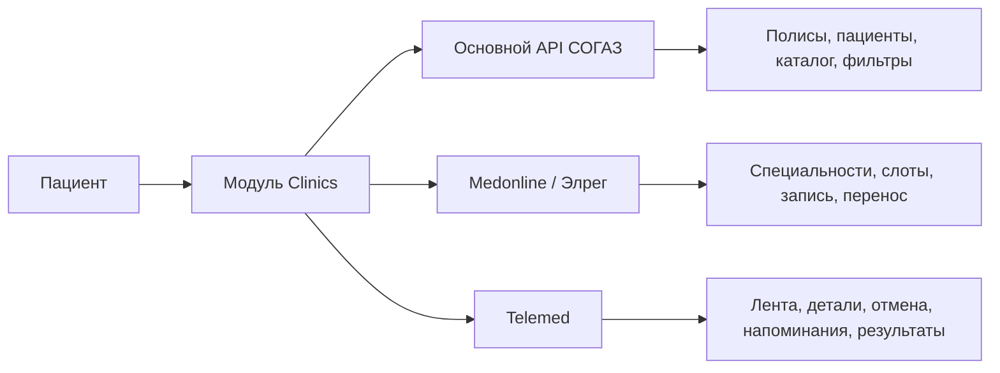

# Клиники и Элрег — карта модуля

Проверено 19 ноября 2026 по рабочей копии `sogaz-mobile`, ветка `fix2/pwa-884`, HEAD `cd4f9d35b`. Клинические файлы соответствуют HEAD. В рабочей копии есть отдельные локальные изменения, в том числе в `mainApiGateway.ts`. Это описание прочитанного фронтенда, без проверки ответов действующего бэкенда.

## Что входит

Каталог клиник, карта, регионы, фильтры, выбор пациента и полиса, авторизация в Элреге, специальности, врачи и слоты, запись, перенос, просмотр события, отмена, напоминания и заключение после приёма. Flexben разобран как соседняя ветка выбора клиники. Запись на анализы, вызов врача и телемедицинские консультации имеют собственные модули и контракты. Общие точки пересечения отмечены ниже.

## Начать отсюда

| Заметка | Содержание |
|---|---|
| [[СОГАЗ/Клиники и Элрег/01 Флоу и экраны]] | Входы, все этапы записи, карта и контакты, перенос, отмена, заключения, Flexben |
| [[СОГАЗ/Клиники и Элрег/02 API СОГАЗ]] | 7 определений запросов Clinics к основному API и зависимости профиля, полисов, Health, Flexben |
| [[СОГАЗ/Клиники и Элрег/03 API Элрег]] | Все 9 определений запросов Medonline, тела запросов и обработка ответов |
| [[СОГАЗ/Клиники и Элрег/04 API Telemed и результаты]] | События, отмена, напоминания и заключения |
| [[СОГАЗ/Клиники и Элрег/05 Данные Redux и правила]] | Идентификаторы, модели, состояние, фильтры, доступность |
| [[СОГАЗ/Клиники и Элрег/06 Авторизация и последовательность запросов]] | Три шлюза, токены, порядок запросов и кеш |
| [[СОГАЗ/Клиники и Элрег/07 Проблемы и Элрег 2.0]] | Подтверждённые особенности кода, риски, варианты решений и вопросы для встречи |
| [[СОГАЗ/Клиники и Элрег/08 Проверка сценариев и карта исходников]] | Чек-лист и файлы для дальнейшего разбора |
| [[СОГАЗ/Клиники и Элрег/09 Целевая архитектура Элрег 2.0]] | Предлагаемый единый вход, контекст пациента, API, надёжные операции и план перехода |
| [[СОГАЗ/Клиники и Элрег/10 Новый контракт Элрега и изменения флоу]] | Что уже переписано по документу backend и как уточняется целевой флоу |

## Срез проекта

Проверено 19 ноября 2026 по рабочей копии ветки `fix2/pwa-884`, HEAD `cd4f9d35b`. В рабочей копии есть локальные изменения, включая Main API gateway. Описано фактическое состояние файлов на момент разбора. Это справочник фронтовой реализации, серверные контракты и сценарии на стенде отдельно не проверялись. Исходники проекта при подготовке заметок не изменялись.

## Главное устройство

Успешная запись создаётся через Medonline, затем видна через Telemed. Идентификаторы, задержка синхронизации и состояние авторизации между этими системами критичны для клиентского сценария.

## Что взять на встречу

Сначала согласовать контракт пациента и полиса, связь идентификаторов клиники и записи, жизненный цикл слота, результат операции при таймауте и синхронизацию с лентой. Затем обсуждать изменения экранов. Подробные вопросы находятся в [[СОГАЗ/Клиники и Элрег/07 Проблемы и Элрег 2.0]].

Основной код — [src/modules/Clinics](/Users/antonratnov/Desktop/sogaz/sogaz-mobile/src/modules/Clinics).
