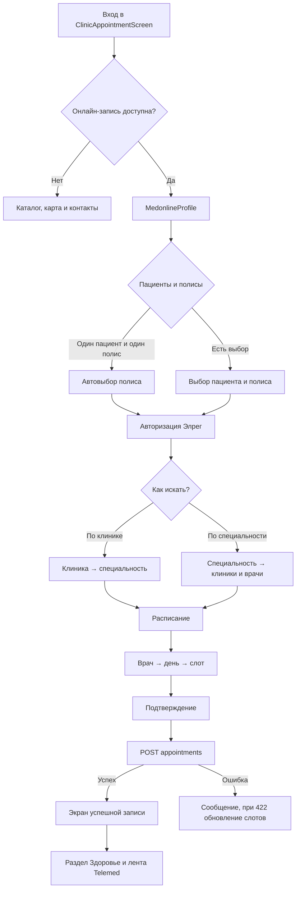

# Флоу и экраны

[[СОГАЗ/Клиники и Элрег/00 Обзор|К оглавлению]]

## Входы

| Источник | Поведение |
|---|---|
| Здоровье → плитка записи в клинику, `DMSTiles` | При онлайн-записи открывает вкладку `specialists`, показывает переключатель. Без неё открывает `clinics`, поиск и выбор региона |
| Полис → действие `clinics`, `BoxedRouteCell` | Передаёт `policyId`, вкладку `clinics`, поиск, регион, скрывает переключатель |
| Предстоящая запись → изменить дату и время | Открывает `ClinicDoctorSchedulesScreen` с `clinicId`, `policyId`, специальностью и `remakeAppointmentId` |
| Карточка клиники → виды помощи | Открывает `MedicalAidTypesScreen`, далее детализацию франшизы |
| Flexben | Общий каталог и отдельная шторка предложений, затем ссылка предложения в WebView |

Экран каталога зарегистрирован в `ClinicsStack` и `PoliciesStack`. В текущем коде есть расхождение типов стартовых параметров — в `ClinicsStack` объявлен `controlIndex`, в `PoliciesStack` и самом экране используется `tab`. При изменении навигации нужно учитывать оба объявления.

## Выбор режима

Онлайн-запись доступна при `bookingIndicator === true && bookingMode === 'medonline'` из Health API. В остальных случаях основной сценарий работает как каталог без авторизации в Medonline. Для `bookingMode === 'map'` при соответствующих параметрах автоматически открывается выбор региона, если регион ещё не выбран.

## Основной путь

### 1. Пациент и полис

`useMedonlineProfile` получает основного пациента, детей и полисы. `usePatientInit` выбирает следующий этап. Для одного пациента и одного полиса выбор автоматический. При нескольких полисах или пациентах показывается выбор. Выбранный полис идёт в `/auth`, ответ заполняет пациента, номер полиса и токен в Redux.

Вход из деталей полиса минует выбор пациента. В каталог без онлайн-записи можно пройти без контекста пациента и полиса.

### 2. Каталог и регион

`useClinicData` получает регионы. Приоритет начального региона — параметр перехода, сохранённый допустимый регион, город профиля, общий вариант. На web выбор хранится в localStorage, в полной нативке сохранение пока не реализовано.

Для выбранного региона сначала загружаются настройки фильтров. После применения фильтров разрешается запрос клиник. Ошибка настроек фильтров также завершает этот этап с запасными значениями.

Карта и список используют одну выборку. Поиск и пользовательская фильтрация выполняются на клиенте. При пустом результате серверного каталога для выбранного региона код может сбросить регион в общий вариант.

### 3. Выбор клиники или специальности

Путь через клинику использует `GET /clinics/{clinicId}/specializations`, затем расписание клиники. Путь через специальность использует общий `GET /specializations`, затем расписание специальности по нескольким клиникам.

Для онлайн-записи в Redux сохраняются выбранные клиника и специальность. Клиника без доступной онлайн-записи открывается в `ClinicDetailScreen`. В карточке доступны адрес, телефоны, часы работы, виды помощи, рейтинг и внешние ссылки при наличии данных. Оценка открывает `evaluateUrl`, награда — `award.link` через `GenericWebviewScreen`. Копирование адреса не требует запроса.

### 4. Врач и время

`ClinicDoctorSchedulesScreen` получает расписание, выбирает начальный день, поддерживает поиск, фильтр времени и представления списка/карты. Нажатие врача открывает `SubmitAppoitmentBottomSheet`.

Шторка проходит состояния `slotSelection → submitDialog`. Сначала пользователь выбирает день и слот, затем подтверждает данные. Создание требует пациента, клинику, врача, слот и номер полиса в Redux. Во время получения расписания или при ошибке доступные дни в выборе скрываются.

### 5. Успех и возврат

`ClinicAppointmentSuccessScreen` показывает выбранные данные из Redux. Действие завершения сбрасывает Clinics и возвращает в Здоровье. Есть обращение к механизму оценки приложения с контекстом `dms-appointment`. Код интерфейса календаря/напоминаний на этом экране закомментирован, активные напоминания доступны в деталях события.

## Перенос

`AppointmentDetailsScreen` для `offline_appointment` получает данные события через Telemed. Для перехода обязательны клиника, специальность и полис. Экран расписания получает `remakeAppointmentId`. При подтверждении отправляется `PATCH /appointments/{id}/remake`, после чего используется общий экран успеха.

Перенос не вызывает создание новой записи через POST. После результата операции инвалидируется лента Telemed.

## Отмена и напоминания

Отмена идёт через `useAppointmentCancellation` в Telemed. Типы `offline_appointment` и `checkup_offline_appointment` требуют `patientId`. Напоминания для `offline_appointment` читают классификатор Medonline и сохраняют выбранные значения через Telemed. См. [[СОГАЗ/Клиники и Элрег/04 API Telemed и результаты]].

## После приёма

Завершённая офлайн-запись отображается через завершённые события. При отсутствии результата пользователь может открыть `AddConclusionScreen`, приложить файлы и комментарий. Сохранение создаёт `/offline_appointment_results`. Просмотр заключения использует отдельный запрос результата. Для MIS и внешних заключений существуют другие запросы.

## Виды помощи и франшиза

`MedicalAidTypesScreen` использует уже переданные `medicalAidTypes`. `FranchiseMedicalAidDetailScreen` группирует услуги по `groupId` и `groupName`, показывает проценты по группе/услуге и общую франшизу по остальным услугам. Собственных запросов у экрана нет. Подключение франшизы ведёт в `PolicyDetails`, вкладка `Payments`, с `policyId`.

## Flexben

Соседний сценарий получает регионы, варианты программы и клиники. `ClinicFlexbenBottomSheet` запрашивает предложения для `policyId`, `clinic`, `region`, `variant`. Пользователь выбирает набор treatments. Предложения фильтруются по точному совпадению набора услуг, затем выбранный `offer.webview` открывается в `GenericWebviewScreen`. Это отдельный контракт от записи в слот Medonline.
