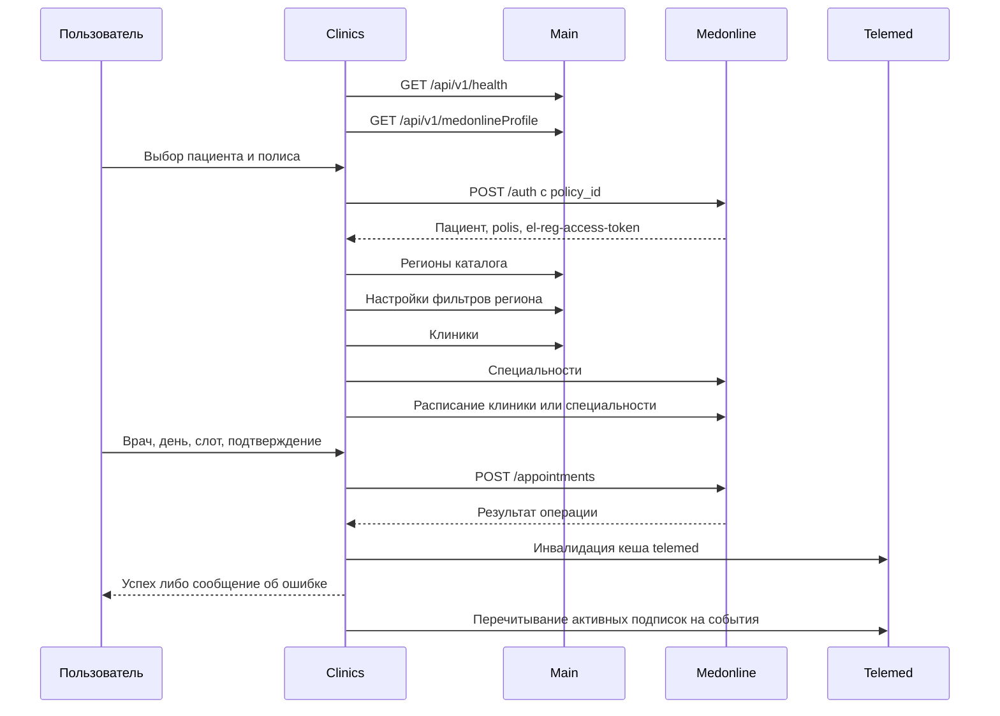

# Авторизация и последовательность запросов

[[СОГАЗ/Клиники и Элрег/00 Обзор|К оглавлению]]

## Шлюзы

| Шлюз | База | Авторизация | Таймаут |
|---|---|---|---|
| Main | `config.BASE_API` | Web production использует cookie-контекст. В других режимах Bearer accessToken. Обёртка `makeBaseQueryWithReauth` | 120 секунд |
| Medonline | Web dev `/medonline/`, иначе `config.MEDONLINE_API` | `/auth` получает `Emp-Authorization: telemedToken`, остальные запросы `EL-REG-ACCESS-TOKEN` из Redux | 120 секунд |
| Telemed | Web dev `/telemed-api/`, иначе `config.TELEMED_API` | Web production использует cookie-контекст, в других режимах `Emp-Authorization: telemedToken`. Обёртка reauth | 120 секунд |

Общие заголовки включают `X-Device-ID`, `User-Agent`, необязательный конфигурационный `X-Access-Token`. Medonline дополнительно передаёт `X-TimeZone` как смещение устройства. Значения токенов и служебных секретов в документацию не включены.

Шлюз Medonline не использует общую обёртку обновления авторизации. При истёкшем токене проверка наличия токена в Redux сама не инициирует переавторизацию.

Фактическая среда определяется конфигурацией сборки и dev proxy. Относительный `/medonline/` сам по себе не означает stage или localhost-бэкенд. Для стенда нужно сверять конфигурацию сборки и target прокси.

## Последовательность онлайн-записи

Диаграмма показывает логические зависимости. Часть запросов реально выполняется параллельно. Общий список специальностей сейчас не полностью защищён условием наличия успешного токена. При выборе клиники также может выполняться лишний запрос расписания специальности.

Инвалидация тега вызывает обновление активных подписок RTK Query. Это не гарантирует немедленную синхронизацию Medonline с Telemed на сервере.

## Кеш

- Medonline читает по ключам query-аргументов. Для общих специальностей аргументов нет, для расписания ID полиса тоже не входит в ключ.
- `/auth` инвалидирует `medonline`, что помогает обновить данные после выбора полиса.
- Создание и перенос инвалидируют другой API — `telemed`, в том числе после ошибки.
- Отмена и сохранение напоминаний инвалидируют `telemed` внутри Telemed API.
- `getMedonlineProfile` не сохраняет неиспользуемый результат после исчезновения подписки.
- Полисный каталог с закешированным пустым массивом принудительно перезапрашивается.

## Завершение и смена контекста

При уходе из основного сценария хук профиля очищает выбранный полис и ID пациента ЛК. Экран расписания при удалении из стека очищает клинику и врача. Успешное завершение использует общий сброс Clinics.

Нужно отдельно проверять прерывание авторизации, возврат назад, смену полиса и ответы уже начатых запросов. В текущем коде ответ `/auth` не проверяется на соответствие актуальному полису перед записью в Redux.
