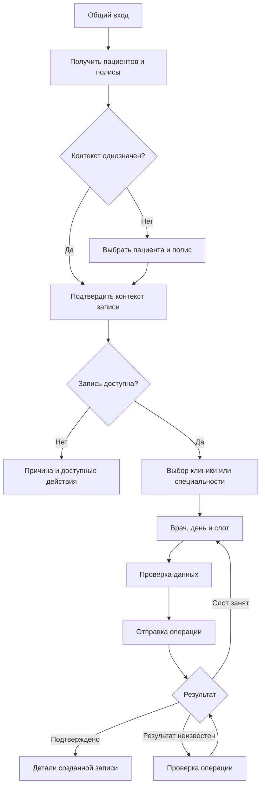

# Целевая архитектура Элрег 2.0

[[СОГАЗ/Клиники и Элрег/00 Обзор|К оглавлению]]

## Уточнение после нового контракта

В переданном 20 ноября API уже описаны единое расписание `/slots`, ответ создания с appointmentId и отмена через `/appointments`. Практическое предложение теперь нужно строить поверх этих ручек. Новый bootstrap и contextId остаются дополнительными вариантами, их не требуется вводить для начала интеграции. Подробное сравнение и оставшиеся вопросы — [[СОГАЗ/Клиники и Элрег/10 Новый контракт Элрега и изменения флоу]].

## Основное решение

Сделать один сценарий записи с единым контекстом пациента и полиса. Все входы — из Здоровья, профиля, полиса или карточки клиники — передают начальные параметры в этот сценарий. Перед показом расписания сервер подтверждает контекст и доступные действия. Фронтенд показывает шаги, хранит выбор пользователя и обрабатывает результат операции.

Для клиента нужен единый API записи, за которым сервер связывает каталог СОГАЗ, Элрег и Telemed. Внутренние сервисы могут сохраняться. Их токены, преобразование идентификаторов и синхронизация не должны управлять переходами экранов.

Это предложение нового контракта. Имена экранов, типы и URL ниже иллюстрируют архитектуру и требуют согласования с backend. Описание текущей реализации находится в заметках 01–08.

## Что означает одна точка входа

Одна точка входа — общий обработчик начала сценария. Ему не обязательно соответствовать отдельный видимый экран с лоадером. Подготовку можно выполнять в контейнере существующего стека и показывать загрузку первого экрана.

```ts
type BookingEntry =
  | {
      mode: 'create'
      patientId?: string
      policyId?: string
      clinicId?: string
      specializationId?: string
    }
  | {
      mode: 'reschedule'
      appointmentId: string
    }
```

`source` для аналитики можно передавать отдельно. Он не должен определять правила доступности или набор запросов.

| Откуда пришли | Что передаём | Что делает общий сценарий |
|---|---|---|
| Здоровье | Без предвыбора | Загружает доступных пациентов и полисы |
| Профиль ребёнка | patientId | Проверяет доступ к ребёнку, предлагает его полисы |
| Полис | policyId | Определяет допустимого пациента по данным сервера, при неоднозначности просит выбрать |
| Карточка клиники | clinicId и известный контекст | Проверяет доступность клиники, сохраняет предвыбор только если он допустим |
| Детали записи | mode=reschedule, appointmentId | Получает пациента, полис и ограничения переноса из существующей записи |

**Для профиля отдельный флоу не нужен.** Он лишь предвыбирает пациента. Если в профиле есть кнопка просмотра всех клиник без записи, она открывает каталог — самостоятельную возможность с общими компонентами карты и списка.

При недоступном предвыборе показываем причину и разрешённый следующий шаг. Не подставляем молча первый полис или другого пациента. Параметры перехода являются подсказками, сервер проверяет принадлежность сущностей пользователю.

## Клиентский путь



1. Загружаем доступных пациентов вместе с их полисами. Если допустимая комбинация одна, используем её. Если несколько — показываем выбор. Отсутствие полиса у основного пациента не мешает записи ребёнка.
2. Сервер проверяет комбинацию и возвращает контекст записи, возможности, регион по умолчанию и ограничения. При недоступности показываем осмысленную причину.
3. Пользователь выбирает путь поиска — клиника или специальность. Оба пути приходят к одному экрану расписания и одной модели слота.
4. Выбор слота формирует предварительную сводку. Выбор не гарантирует резервирование. Если продукт требует удержание слота, backend должен отдельно поддержать резерв с временем истечения.
5. Сервер при создании повторно проверяет доступность и возвращает запись или операцию, результат которой можно запросить.
6. После подтверждения показываем данные серверной записи. Лента Здоровья обновляется как представление этой записи и не определяет, состоялось ли создание.

## Разделение ответственности на фронтенде

| Часть | Ответственность |
|---|---|
| Вход сценария | Разбор параметров, восстановление контекста, выбор начального шага |
| API слой | Запросы, кеш, нормализация транспорта и ошибок |
| Модель сценария | Допустимые переходы, зависимости выбора, состояние операции |
| Экраны | Отображение состояния и отправка пользовательских действий |
| Общие компоненты | Карта, карточки клиники/врача, выбор дня и слота |

Не нужен один огромный хук, который одновременно запрашивает всё, меняет Redux, открывает шторки и навигирует. Для небольшого сценария достаточно reducer с явными событиями и нескольких query-хуков. Специальная библиотека state machine не обязательна.

Предлагаемая структура может находиться внутри существующего `Clinics` без массового переименования файлов

```text
Clinics/
  api/            контракт клиента и запросы
  model/          контекст, reducer, события, селекторы
  screens/        каталог, расписание, подтверждение, детали
  components/     карта, карточки, выбор пациента и времени
```

Локальные состояния раскрытия шторок и строка поиска остаются в UI. Их не нужно смешивать с правом пациента записаться по полису.

## Что хранить и где

RTK Query хранит ответы сервера — пациентов, полисы, клиники, расписание, запись, состояние операции. Модель сценария хранит пользовательский выбор и идентификаторы. Не копируем каждый ответ API в Redux через matchFulfilled.

```ts
type BookingSelection = {
  contextId: string
  clinicId?: string
  specializationId?: string
  doctorId?: string
  date?: string
  slotId?: string
}
```

`contextId` — непрозрачная ссылка на подтверждённый сервером контекст пациента и полиса, с ограниченным сроком жизни. Он не заменяет авторизацию. Сервер проверяет владельца и актуальность контекста при каждой операции. Если backend выбирает stateless-контракт, вместо ID можно передавать пару patientId/policyId, сохранив те же правила проверки и кеша.

Данные для отображения получаем из кеша по ID. Операция подтверждения фиксирует неизменяемый снимок входных данных. Изменение выбора после отправки не должно менять уже выполняющуюся операцию.

| Изменился выбор | Что сбрасываем |
|---|---|
| Пациент или полис | Контекст, клинику, специальность, врача, день и слот |
| Клиника или специальность | Врача, день и слот |
| Врач | День и слот |
| День | Слот |
| Регион/фильтры скрыли выбранную сущность | Проверяем выбор, очищаем недопустимый предвыбор |

Сброс происходит одним событием reducer. Ключи кеша включают контекст и параметры выборки. Устаревший ответ другого контекста не должен менять текущий сценарий. Для этого нужны соответствующие ключи и проверка актуальности операции, одной отмены запроса недостаточно.

При выходе из аккаунта очищаются состояние сценария и приватный API-кеш. После PIN восстанавливается входной маршрут, затем контекст заново проверяется для текущего пользователя.

## Явные состояния и ошибки

| Состояние | Что показываем | Следующее действие |
|---|---|---|
| initializing | Загрузку входных данных | Повторить при ошибке |
| choosingContext | Пациентов и полисы | Выбрать допустимую комбинацию |
| browsing | Каталог или специальности | Выбрать направление поиска |
| choosingSlot | Расписание | Выбрать слот |
| reviewing | Сводку визита | Подтвердить или изменить выбор |
| submitting | Отправку операции | Заблокировать повторное подтверждение |
| resolvingOperation | Проверку результата | Продолжить проверку той же операции |
| completed | Подтверждённую сервером запись | Открыть детали |
| blocked | Причину недоступности | Выполнить разрешённое альтернативное действие |

Ошибка загрузки списка хранится у соответствующего запроса и показывает повтор. Пустой успешный ответ показывает отсутствие результатов. Для каждой загрузки не нужен отдельный глобальный этап.

Ошибки мутации имеют машинный `code`, понятный текст и при необходимости поле/действие. Например, `SLOT_UNAVAILABLE` обновляет расписание и сбрасывает слот, `POLICY_UNAVAILABLE` возвращает к выбору контекста, `CONTEXT_EXPIRED` инициирует его восстановление. Один HTTP 422 не определяет все эти переходы.

## Единый API для клиента

Предлагаемый namespace `/api/v2/clinic-booking`. Backend может реализовать его как BFF — слой, который собирает необходимые клиенту данные из внутренних систем.

| Метод и путь | Назначение | Основной контракт |
|---|---|---|
| GET `/bootstrap` | Начальные данные | Пациенты, их допустимые полисы, сервисные возможности, начальные настройки |
| POST `/contexts` | Подтвердить контекст | Вход patientId/policyId или appointmentId для переноса. Выход contextId, expiresAt, пациент, полис, capabilities, причины ограничений |
| GET `/catalog` | Каталог клиник и его фильтры | contextId для записи либо явно заданный browse-режим, регион, фильтры, поиск, cursor. Ответ items, facets, регион, nextCursor |
| GET `/specializations` | Специальности | contextId, необязательный clinicId. Один контракт для обоих путей поиска |
| GET `/availability` | Расписание | contextId, specializationId, необязательные clinicId/doctorId, ограниченный диапазон дат, cursor. Единая модель клиник, врачей, слотов |
| POST `/appointments` | Создать запись | contextId, slotId, подтверждённые контактные данные при необходимости, Idempotency-Key. Ответ appointment либо operation |
| GET `/operations/{operationId}` | Установить результат | pending, succeeded с appointment, failed с кодом ошибки |
| GET `/appointments/{appointmentId}` | Детали и разрешённые действия | Запись, статус, часовой пояс, capabilities, версия |
| POST `/appointments/{appointmentId}/reschedule` | Перенести | Новый slotId, контекст, ожидаемая версия и Idempotency-Key |
| POST `/appointments/{appointmentId}/cancel` | Отменить | Ожидаемая версия, причина если требуется, Idempotency-Key |
| PUT `/appointments/{appointmentId}/reminders` | Напоминания | Полный желаемый набор reminderIds |

Регионы и доступные фильтры приходят вместе с начальным контекстом или facet-частью каталога. Для большого списка регионов допустима отдельная поисковая ручка. Классификатор напоминаний можно возвращать в деталях записи или кешируемом справочнике.

Каталог без записи должен иметь явный browse-режим с ограниченными возможностями. Отсутствие contextId не должно автоматически открывать данные полиса. Поиск и фильтры больших списков лучше выполнять на сервере, чтобы список и карта отражали одинаковую выборку. Для карты контракт должен поддерживать bounds и кластеризацию либо документированный предел выдачи, иначе маркеры первой страницы будут выглядеть как полный каталог.

Результаты приёма и файлы можно оставить отдельным API медицинской карты. Они не нужны для открытия экрана записи.

### Почему ручек не обязано стать сильно меньше

Цель — убрать дублирование контрактов и последовательные запросы для открытия экрана. Детали, создание, перенос и отмена имеют разную семантику и сохраняют отдельные операции. Запихивать их в один универсальный endpoint с action не нужно.

Выигрыш достигается объединением общего и полисного профилей в bootstrap, общего и клинического расписания в availability, фильтров с каталогом, а также переносом авторизации Элрега на сервер. Число внутренних backend-вызовов при этом может остаться прежним. Конкретное количество запросов и задержки стоит измерить по каждому пути.

## Контракт записи и надёжность операций

```ts
type Appointment = {
  id: string
  version: number
  status: 'confirmed' | 'cancelled' | 'completed'
  patientId: string
  policyId: string
  clinic: { id: string; name: string; address: string }
  doctor: { id: string; name: string }
  specialization: { id: string; name: string }
  startsAt: string
  endsAt: string
  timeZone: string
  capabilities: {
    canReschedule: boolean
    canCancel: boolean
    canEditReminders: boolean
  }
}
```

Это минимальный пример. Если у провайдера есть ожидание подтверждения, нужен явный статус `pendingConfirmation` и отдельное представление этого состояния. Нельзя показывать «Вы записаны» до фактического подтверждения.

Время передаётся в ISO с однозначным смещением и IANA timeZone клиники. Основное время показываем в зоне клиники, при различии с устройством явно подписываем зону. ID пациента, клиники и записи в публичном API имеют единую систему, соответствие внутренним Medonline/LK/Telemed ID хранит backend.

Перед отправкой клиент создаёт и сохраняет ключ идемпотентности. Повтор того же намерения после таймаута использует тот же ключ и неизменное тело. Backend сохраняет результат ключа в пределах пользователя и типа операции, конфликтующее тело отклоняет. Новое осознанное действие получает новый ключ.

Если первый ответ с operationId потерян, клиент должен уметь повторить исходный запрос с тем же ключом и получить ту же операцию. Иначе один GET по operationId не решает неопределённость таймаута. После перезапуска приложения незавершённая операция восстанавливается из минимальных локальных метаданных, привязанных к аккаунту, без сохранения медицинских данных и токенов Элрега.

Backend должен обеспечить идемпотентность и сверку результата также на границе с провайдером. Если провайдер её не поддерживает, слепой повтор создания недопустим — сервер устанавливает фактический результат и сохраняет неопределённый статус до выяснения. Гарантировать отсутствие дублей только фронтендом невозможно.

При переносе существующая запись сохраняется до подтверждения новой договорённости. Если провайдер не поддерживает атомарный перенос, backend определяет промежуточные состояния и восстановление, фронтенд их показывает. Отмена и перенос проверяют версию записи, чтобы не применить действие к устаревшему состоянию.

Проверка операции использует ограниченный backoff, учитывает отсутствие сети и видимость приложения. После длительного ожидания показывается «Результат уточняется» с возможностью вернуться к проверке. Pending-операция не должна превращаться в ошибку «запись не создана» только из-за истечения клиентского таймера.

## Синхронизация с Telemed

Сервис записи отвечает за достоверный результат команды. После подтверждения изменение доставляется в ленту через надёжную серверную доставку событий, например transactional outbox с повторной обработкой. Обработчики ленты должны быть идемпотентными и учитывать версию записи.

Экран успеха сразу открывает полученный appointment. Обновление ленты происходит отдельно. При задержке отображается состояние синхронизации, повторное создание пользователю не предлагается. Для поддержки нужен correlationId операции и связь с внутренним ID провайдера.

Конкретный источник истины за BFF зависит от возможностей Элрега. Его необходимо назначить явно: слой записи не должен подтверждать успех, который провайдер ещё не подтвердил.

## Что можно сделать без нового backend

1. Объединить входы общим типом параметров, в том числе вход из профиля и перенос.
2. Ввести одну модель контекста и явные переходы с очисткой зависимого выбора.
3. Убрать второй запрос расписания, когда выбрана конкретная клиника.
4. Привязать загрузки и кеш к актуальному пациенту/полису, исключить применение устаревших ответов.
5. Разделить ошибку, отсутствие результатов и загрузку, обеспечить повтор запросов.
6. Вынести текущие Main/Medonline/Telemed вызовы в адаптер с едиными моделями для экранов.

Адаптер позволит позже заменить транспорт без переписывания UI. Полностью убрать отдельную авторизацию Элрега, обеспечить идемпотентность и сократить сетевую цепочку одним фронтовым рефакторингом нельзя. Простое переименование существующих запросов в единый хук сеть не сокращает.

## Поэтапный переход

| Этап | Результат | Условие готовности |
|---|---|---|
| 1. Согласовать сценарии и состояния | Контракт контекста, слота, записи и ошибок | Подтверждены дети, несколько полисов, перенос, отмена, неопределённый результат |
| 2. Упорядочить фронтенд на старом API | Общий вход и модель сценария | Оба пути записи и вход из профиля проходят одинаковые проверки |
| 3. Подключить BFF для чтения | Bootstrap, каталог и расписание | Совпадают доступность и ID, измерены время открытия и количество запросов |
| 4. Перевести операции | Создание, перенос, отмена, напоминания | Проверены таймауты, повторы и синхронизация ленты |
| 5. Удалить старую ветку | Один поддерживаемый контракт | Завершён согласованный период наблюдения и отката |

При включении по feature flag выбранный вариант закрепляется на весь сценарий и сохраняется с незавершённой операцией. Создание записи нельзя отправлять одновременно в старый и новый API для сравнения. При неопределённом результате нельзя переключаться на старый путь и создавать повторно.

## Критерии стабильности

- Все входы используют одинаковые правила выбора пациента и полиса.
- Ребёнок может записаться независимо от наличия полиса у основного пациента.
- Смена контекста не оставляет чужие данные и выбранные слоты.
- Смена дня очищает слот, подтверждение проверяет актуальный выбор.
- Слот, занятый другим клиентом, даёт понятный ответ и свежее расписание.
- Потеря ответа, повторное нажатие и перезапуск не создают второй визит по тому же намерению.
- Перенос и отмена корректно переживают устаревшие данные и конкурирующие действия.
- Экран успеха показывает подтверждённую запись, даже если лента обновляется с задержкой.
- Время визита одинаково понимается пользователем, клиникой и сервером.
- Ошибку провайдера можно найти по correlationId без записи токенов и персональных данных в клиентские логи.

## Что предложить на встрече

«Давайте сделаем один сценарий записи с контекстом пациента и полиса. Вход из профиля будет передавать выбранного пациента в тот же сценарий. Клиенту нужен единый контракт каталога, расписания и записи, а связь СОГАЗ, Элрега и Telemed должна находиться на сервере. Сначала согласуем статусы операции, идемпотентность и ошибки, затем изменим экраны. Сокращать будем лишние запросы и зависимость между ними».
