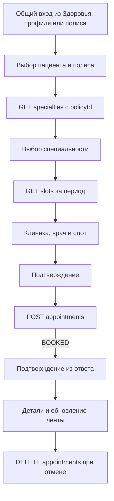

# Новый контракт Элрега и изменения флоу

[[СОГАЗ/Клиники и Элрег/00 Обзор|К оглавлению]] · [[СОГАЗ/Клиники и Элрег/09 Целевая архитектура Элрег 2.0|Целевая архитектура]]

Источник — [апи элрег.docx](/Users/antonratnov/Downloads/апи%20элрег.docx), переданный 20 ноября 2026. Документ описывает пять операций. Наличие описания не подтверждает развёртывание ручек на конкретном стенде. Базовый URL и правила авторизации в документе не указаны.

## Что уже изменено в контракте

Новый API объединяет получение расписания по специальности и клинике, принимает policyId явно и возвращает созданную запись с ID, временем и статусом. Отмена описана в том же публичном namespace appointments. Это позволяет упростить клиентский сценарий без введения полного BFF из предыдущего предложения.

| Операция | Контракт документа | Что даёт фронтенду |
|---|---|---|
| Специальности | GET `/api/v1/specialties?policyId={policyId}` | Список для выбранного полиса |
| Расписание | GET `/api/v1/slots?policyId={policyId}&specialtyId={specialtyId}&from={ISO}&to={ISO}` | Один запрос для обоих путей поиска |
| Создание | POST `/api/v1/appointments` | Готовая запись с appointmentId и статусом BOOKED |
| Список визитов пациента | GET `/internal/v1/appointments?patientId={patientId}&page=0&size=20&sortDirection=DESC` | Внутренний контракт для интеграций, не готовая публичная ручка фронтенда |
| Отмена | DELETE `/api/v1/appointments/{appointmentId}` | Обновлённая запись со статусом CANCELLED |

## Специальности

Ответ — массив `{id, title, description, iconUrl}`. description и iconUrl могут быть null. В отличие от текущего фронтового DTO документ не описывает лимиты посещений, возрастную группу и франшизу специальности. Нужно выяснить, нужны ли эти данные в новом UI и откуда они будут получаться.

В запросе нет clinicId. Поэтому для пути «сначала клиника, затем специальность» пока не описано, как получить специальности именно выбранной клиники. Варианты — согласованный фильтр clinicId, включение специальностей в карточку клиники либо изменение пользовательского порядка выбора. Вычислять доступные специальности по последовательным запросам всех расписаний не стоит.

## Расписание

Обязательные параметры в примере — policyId, specialtyId, from, to. Дополнительные — clinicId, doctorId, doctorName.

Ответ имеет вид `clinics[] → doctors[] → slots[]`. Клиника содержит clinicId, misClinicId, name и address. Врач содержит doctorId и fullName. Слот содержит timeSlotId, startsAt и endsAt.

В создание передаётся clinicId. Назначение misClinicId и связь clinicId с существующим каталогом СОГАЗ нужно подтвердить. По одному названию поля нельзя подменять ID для существующего API.

Документ показывает время с суффиксом Z, то есть UTC. Правило отображения в зоне клиники и сама timeZone не описаны. Указание UTC позволяет однозначно передать момент, но само не сообщает пользователю местное время клиники.

В ответе расписания не описаны координаты, контакты, рейтинг и виды помощи. Для текущей карты/карточки клиники потребуется существующий каталог либо расширение нового ответа. Пагинация, максимальный период и ограничения объёма ответа также требуют уточнения.

## Создание

```json
{
  "policyId": "<policyId>",
  "clinicId": "<clinicId>",
  "doctorId": "<doctorId>",
  "timeSlotId": "<timeSlotId>",
  "specialtyId": "<specialtyId>",
  "comment": null
}
```

ФИО, телефон, дата рождения и номер полиса больше не передаются в примере создания. По форме контракта сервер должен получать нужные сведения по контексту и policyId. Как именно определяются пациент, контакты и право доступа, необходимо подтвердить.

Ответ 200 содержит appointmentId, clinicId, clinicName, doctorId, doctorFullName, startsAt, endsAt, status=BOOKED, policyId. Этого достаточно, чтобы показать подтверждение по ответу сервера. Адрес, специальность и часовой пояс в примере ответа отсутствуют, поэтому для сводки нужно явно определить источник этих полей.

Idempotency-Key, операция проверки результата и ошибки занятого слота в документе не описаны. Сохранение appointmentId помогает после полученного ответа, но не решает потерю самого ответа на POST.

## Отмена и список

DELETE возвращает тот же набор данных со статусом CANCELLED. Это позволяет обновить карточку визита напрямую из ответа.

Внутренний список принимает patientId и дополнительные параметры пагинации, возвращает items и page с number, size, totalElements, totalPages. Документ называет его сценарием получения визитов для повторной записи. Он не описывает замену публичной ленты Telemed.

Для приложения нужен согласованный публичный путь чтения собственных записей: существующая лента с гарантированной связью ID либо защищённый внешний endpoint. Вызов `/internal/...` из PWA/мобильного приложения не следует закладывать без отдельного подтверждения назначения и авторизации.

## Практический флоу на новом контракте



Самый полно описанный путь — от специальности. Если клиника уже известна, slots получает clinicId. Получение доступных специальностей этой клиники пока требует уточнения.

Общий вход остаётся один. Профиль передаёт выбранного пациента, полис — выбранный policyId. Инициализация может использовать текущие данные профилей и полисов до появления нового bootstrap. Специальный contextId не обязателен, если backend проверяет policyId и владельца на каждом запросе.

На пути от выбранного полиса до подтверждения описаны три основные операции: специальности, слоты, создание. Это не полный бюджет запросов экрана — пациенты, полисы, география, каталог и лента могут требовать дополнительных данных.

## Что корректируем в архитектурном предложении

| Предыдущее предложение | Решение с учётом нового документа |
|---|---|
| Единый availability | Уже есть slots с фильтрами. Использовать согласованную новую ручку |
| Возврат созданной записи | Уже описан. Экран успеха строить по ответу POST |
| Отмена через API записи | Уже описана. Уточнить связь с ID в ленте |
| Bootstrap и contextId | Опциональное дальнейшее улучшение. Не делать обязательным условием внедрения новых ручек |
| Скрытая серверная авторизация провайдера | В документе нет `/auth`, но это не доказывает отсутствие отдельной авторизации. Нужна схема headers/cookies |
| Уменьшение числа запросов | Сначала убрать дублирование расписаний. Каталог и профили объединять только при реальной необходимости |

## Что ещё согласовать

1. Какой base URL и способ авторизации? Нужен ли клиенту токен Элрега?
2. Как policyId определяет пациента, включая ребёнка и несколько полисов? Как выбираются контактные данные?
3. Как получить специальности конкретной клиники?
4. Как новый clinicId связан с Medonline ID и ID адреса текущего каталога? Для чего клиенту misClinicId?
5. Сохраняются ли текущие регионы, карта, фильтры, франшиза и виды помощи?
6. Каковы коды ошибок занятого слота, недоступного полиса, отсутствия доступа и истёкшей авторизации?
7. Есть ли идемпотентность и способ выяснить результат создания после таймаута?
8. Где новый контракт переноса, напоминаний и чтения деталей одной записи?
9. Как appointmentId связан с событием Telemed, когда запись появляется в ленте и как туда доставляется отмена?
10. Как заданы зона клиники, границы from/to, максимальный период расписания и обработка больших ответов?

Эти вопросы относятся к полноте переданного описания. Документ не позволяет утверждать, что соответствующие возможности отсутствуют в реализации backend.
