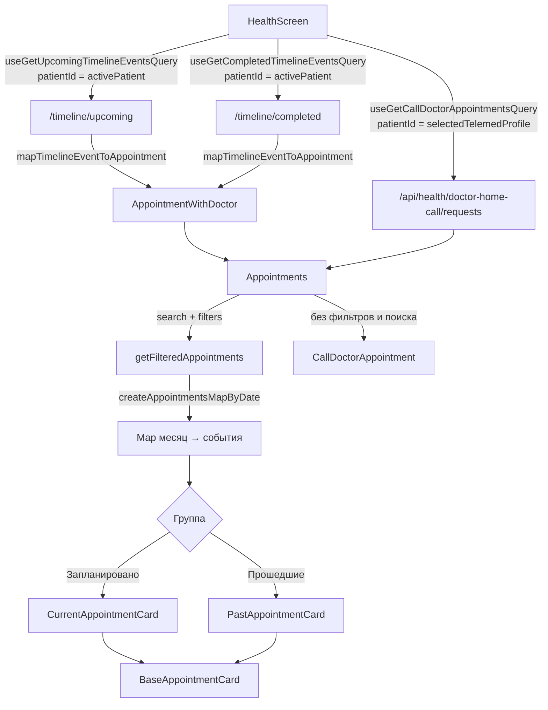

# Таймлайн «События» (экран Здоровье) — обзор

> [!info] Что это
> Блок **«События»** на `HealthScreen`: три сворачиваемые группы карточек.
> 1. **Вызовы врача на дом** (временное решение, отдельный API)
> 2. **Запланировано** (`/timeline/upcoming`)
> 3. **Прошедшие** (`/timeline/completed`)
>
> Внутри групп карточки сгруппированы по месяцам («Октябрь 2026 г.»). Сверху блока кнопки фильтра и поиска по врачу/специальности.

## Заметки

| Что | Где |
|---|---|
| Данные, маппинг, фильтры | эта заметка |
| Карточки и **матрица шевронов** | [[01 Карточки и шевроны]] |
| Баги верстки и логики, план правок | [[02 Баги и план правок]] |

## Файлы (`src/modules/Health`)

| Файл | Роль |
|---|---|
| `screens/HealthScreen/HealthScreen.tsx:551` | Делает запросы, маппит и передает данные в `Appointments` |
| `components/appointments/Appointments.tsx` | Оркестратор: три группы, обработчики навигации, сборка `actions` для карточек |
| `components/appointments/AppointmentsLayout.tsx` | Заголовок «События», кнопки фильтра/поиска, поле поиска |
| `components/appointments/AppointmentsGroupCollapsible.tsx` | Обертка над `components/UI/Collapsible` со счетчиком |
| `components/appointments/AppointmentsGroup.tsx` | Месячные секции + `FlatList` карточек (`scrollEnabled=false`) |
| `components/appointments/CallDoctorAppointmentGroup.tsx` | Копия `AppointmentsGroup` для вызовов врача |
| `components/appointments/BaseAppointmentCard.tsx` | Общий каркас карточки (дата, заголовок, врач, клиника, actions, шевроны) |
| `components/appointments/CurrentAppointmentCard.tsx` | Карточка «Запланировано»: бейдж, кнопки отмены/подключения, подсказка «врач скоро свяжется» |
| `components/appointments/PastAppointmentCard.tsx` | Карточка «Прошедшие» |
| `components/appointments/CallDoctorAppointment.tsx` | Карточка вызова врача (без нажатий и шевронов) |
| `helpers/mapTimelineEventToAppointment.ts` | DTO события → `AppointmentWithDoctor` |
| `helpers/createAppointmentsMapByDate.ts` | Группировка по месяцам |
| `helpers/createCallDoctorAppointmentsMapByDate.ts` | То же для вызовов врача |
| `helpers/filterAppointmentsByFilters.ts` + `hooks/useAppointmentsFilters.ts` | Фильтры (даты, категории, типы) и поиск |
| `utils/appointmentActionAvailability.ts` | `isConsultationActiveNow`, `canJoinConsultationNow`, `canCancelConsultationNow` (логика из iOS) |
| `hooks/useUpcomingConsultationRefetch.ts` | Рефетч planned через 10 с после старта ближайшей онлайн-консультации (если старт < 24 ч) |
| `types/appointment-types.ts`, `healthSlice/types.ts` | Типы |

## Поток данных



> [!warning] Разные идентификаторы пациента
> Timeline-запросы берут `activePatient = selectedTelemedProfile ?? telemedProfile`, а вызовы врача — только `selectedTelemedProfile?.id` с `skip`, если его нет. Если `selectedTelemedProfile` пуст, группа вызовов врача не загрузится, хотя planned/past придут.

## Три источника событий

### 1. Вызовы врача на дом
- Тип `CallDoctorAppointmentType { id, applicantDate, status }`, статусы `CREATED | PROCESSING | IN_PROGRESS | APPROVED | REJECTED`.
- Группа показывается, только если есть хотя бы одна заявка (`hasCallDoctorAppointments`).
- Нет разделения на planned/past: завершенные (`APPROVED`) и отмененные (`REJECTED`) лежат в той же группе.
- Не участвуют в поиске, фильтрах и сортировке.
- Карточка не нажимается, шевронов нет.
- В коде помечено `TODO: решение не целевое, подлежит удалению после добавления событий вызова врача в основной timeline`.

| Статус | Бейдж | Вариант бейджа | Описание |
|---|---|---|---|
| `CREATED`, `PROCESSING` | В обработке | info | Заявка оформлена, с вами свяжутся |
| `IN_PROGRESS` | В работе | positive | Заявка оформлена, с вами свяжутся |
| `APPROVED` | Согласована | info | Заявка завершена |
| `REJECTED` | Отменена | negative | Заявка отозвана |

### 2. Запланировано (`UpcomingTimelineEvent`)
Дата берется из `will_be_held_at`. Данные в `data` (`UpcomingEventData`): врач, специализация, клиника, `appointment` (state, type_slug `chat|video|audio`, start/end), `medical_request`, `consultation_type`, флаги `can_be_cancelled / can_be_shifted / can_be_edited / chat_available`, `message`, `provider` и т. д. События без `data` отбрасываются в `HealthScreen`.

### 3. Прошедшие (`CompletedTimelineEvent`)
Дата из `performed_at`, плюс `category` (`consultations | prescriptions | lab_orders | researches | questionnaires | vaccines | injuries | diseases | checkup`). В `data`: `result_id`, `prescription.attachment.file_url`, `survey_url`, `clinic_survey_url`, `mis_provider` и др. В `transformResponse` есть временный фикс: `lab_orders_sent` с провайдером `kdl` отбрасывается (PWA-106, «удалить после 22-02-2026»).

## Маппинг DTO → `AppointmentWithDoctor`

### `category` (`getAppointmentCategory`)
| Источник | Условие | Категория |
|---|---|---|
| completed | `questionnaires` | `surveys` |
| completed | `researches`, `lab_orders`, `vaccines`, `injuries`, `diseases`, `prescriptions`, `checkup` | `medcard` |
| completed | `consultations` и все остальные | `consultations` |
| upcoming | `appointment`, `ta_appointment`, `opinion`, `transcription_*`, `checkup_transcription_*`, `oms/legal/financial/mis_consultation` | `consultations` |
| upcoming | `offline_appointment`, `mis_appointment` | `clinicRegistration` |
| upcoming | есть `data.questionnaire` | `surveys` (но не достижимо, см. ниже) |
| upcoming | остальное (в т. ч. все analysis-типы) | `consultations` |

> [!note] Опросы в planned
> Ветка `data.questionnaire → surveys` стоит после проверок по типу и срабатывает только для типов вне списков выше. Отдельного типа опроса в `TimelineEventType` нет, так что для planned категория `surveys` практически недостижима.

### `consultationType` (`online | analyses | checkup | null`)
- `online`: `appointment`, `ta_appointment`, `opinion`, `transcription_online`, `oms/legal/financial/mis_consultation`
- `analyses`: `set_lab_choice`, `lab_orders_sent`, `lab_results_*`, `external_lab_results_*`, `helix/invitro_external_lab_order_upcoming`
- `checkup`: `checkup_transcription_online/offline` (в `category` они при этом `consultations`). Заметьте: `transcription_offline` даёт `null`, то есть под фильтры по типу консультации не попадает.
- всё остальное (`offline_appointment`, `mis_appointment`, `transcription_offline`, `self_added_*`, `mis_prescription`, записи вакцин/травм и т. д.) → `null`

### `medcardType` (`conclusions | analyses | diagnostics`)
- completed: `prescriptions` → conclusions; `lab_orders` → analyses; `researches` или тип `instrumental_diagnostics_result` → diagnostics
- upcoming: analysis-типы → analyses; `instrumental_diagnostics_result` → diagnostics

### `isAnalysis`
Тип входит в `ANALYSIS_EVENT_TYPES`: `self_added_analyses`, `set_lab_choice`, `lab_orders_sent`, `lab_results_(partially_)ready`, `external_lab_results_(partially_)ready`, `helix/invitro_external_lab_order_upcoming`, `cancel_lab_order_manually/expired/expired_policy`.

### Прочие производные поля
| Поле | Откуда |
|---|---|
| `title` | `human_type_name` → `description` → «Событие» |
| `datetime` | см. выше; невалидная дата → `DateTime.now()` |
| `doctorName` | upcoming: first+middle+last; completed: `full_name` или ФИО |
| `doctorAvatarUrl` | `TELEMED_API + avatar.image_urls.original` (без `/api`); если аватара нет, получится просто `TELEMED_API` |
| `eventState` | upcoming: `appointment.state`; completed: всегда `unknown` |
| `shouldDoctorGetInTouchSoon` | upcoming + online + до начала < 1 часа (в т. ч. отрицательное значение, т. е. уже началось) |
| `resultId, prescriptionUrl, surveyUrl, clinicSurveyUrl, performedAt` | только completed |
| `oms*` | только `oms_consultation` |

## Бейдж даты (`BaseAppointmentCard`)
```
appointmentInProgress → «Сейчас»
oms_consultation      → дата заглавными
doctorName || performedAt → «d MMM, HH:mm»
иначе → «Подбираем время»
```
Следствие: planned-событие без врача (например анализ) показывает «Подбираем время», хотя `will_be_held_at` есть.

## Фильтры и поиск
- Поиск работает по `doctorName` и `doctorSpecialty` (debounce 300 мс) и **скрывает все события без врача**, как только введен текст.
- Фильтры: период (неделя / прошлая неделя / прошлый месяц / произвольный), категории (`consultations`, `clinicRegistration`, `medcard`, `surveys`), подтипы консультаций и медкарты. Если ни одна категория не включена, категорийный фильтр отключен.
- Применяются к planned и past одинаково, к вызовам врача не применяются.
- При нажатии поиска/«Применить» раскрываются planned и past (но не вызовы врача).

## Группы и сворачивание
- Начальное состояние: все три группы **свернуты**.
- Счетчик считается после поиска и фильтров; при `0` не показывается (`isCounter={!!count}`).
- Пока группа `isFetching`, заголовок заблокирован (`Pressable disabled`) и вместо шеврона показывается спиннер.
- Сортировки на клиенте нет: порядок месяцев и карточек определяется порядком ответа API.
